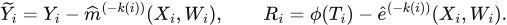
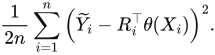

# DML_CausalCustom

## Equation display and revenue units

Equations are now embedded vector images so they remain readable in Markdown
viewers that do not run GitHub's MathJax. Display equations retain expandable
LaTeX source. `equations/source.json` and `render_equations.cjs` preserve the
editable rendering inputs; no extra package is needed to read the files.

Keep the log1p measurement view if it is useful for your skewed revenue data.
For a complementary euro/percentage view, see
[Revenue reporting](REVENUE_REPORTING.md), including a supported Tweedie
log-link nuisance configuration and the distinction from log-label regression.

## Research informed recommendation extension

The current version adds `LightweightDRLearner` in the same standalone module,
with a shared outcome nuisance, independent policy evaluation, optional causal
isotonic calibration, explicit overlap diagnostics and bounded final trees.
The original R-learner and pipeline remain available.

- [Research review and 24 references](RESEARCH_REVIEW.md): current methods,
  documented organizational uses, and proposed ecommerce applications.
- [New mathematics and algorithm](METHODS_V2.md): DR scores, calibration,
  policy values, inference assumptions and memory boundaries.
- [Recommendation notebook](run_recommendations.ipynb): real-data configuration
  using `data_definition` and `industry`, with optional product attributes.
- `recommendation_pipeline.py`: separate full workflow with original-scale
  revenue policy evaluation, group splits, costs, support and reports.

```python
from recommendation_pipeline import RecommendationConfig, run_recommendations

cfg = RecommendationConfig(
    x_cols=['data_definition', 'industry'],
    w_cols=['day', 'week', 'month', 'device', 'channel'],
    discount_input_is_percent=True,
    # product_col='product_id',           # output key, never a treatment
    # embedding_cols=['embedding_0', ...], # optional precomputed numeric features
    calibrate=False,
)
fitted, report = run_recommendations(df, cfg)
```

Default split fractions are 50/20/10/20 by unique user for fit, selection,
reserved calibration and test. The calibration block is reserved even when
calibration is off. `known_propensities` accepts constant randomized assignment
probabilities in explicit category order, with no action-vocabulary filtering.
`split_indices` can provide four externally purged group-disjoint subsets of
the eligible frame; temporal maturity/purging is not inferred automatically.
The policy comparison is against the configured reference, not the historical
stochastic policy. A large number of products does not require a large action
space. Product-level predictions borrow structure from attributes and must
not be described as independently identified effects for every SKU.

Install `requirements.txt` for either notebook; `pip install -e .` installs the
standalone module containing both estimators. **34 tests passed** in the
recorded current-environment run. Production accuracy and large-data peak
memory remain unverified. The original implementation guide follows.

A reusable, memory-conscious causal R-learner with LightGBM nuisance models
and a **custom LightGBM final-stage objective**. The estimator is one independent
module: [`causal_dml.py`](causal_dml.py). The lead/discount workflow is separate:
[`pipeline.py`](pipeline.py).

The full derivation, gradients, Hessian, leaf updates, coordinate algorithm,
assumptions, and memory analysis are in **[MATH.md](MATH.md)**. GitHub renders
the Markdown, and the embedded equation images do not require a math engine.

## What changes in the final stage?

After cross-fitting the outcome and treatment nuisance models, define



<details>
<summary>Copy LaTeX source</summary>

```latex
\widetilde Y_i=Y_i-\widehat m^{(-k(i))}(X_i,W_i),\qquad
R_i=\phi(T_i)-\widehat e^{(-k(i))}(X_i,W_i).
```

</details>

The final stage minimizes the **joint** residual loss



<details>
<summary>Copy LaTeX source</summary>

```latex
\frac{1}{2n}\sum_{i=1}^{n}
\left(\widetilde Y_i-R_i^\top\theta(X_i)\right)^2.
```

</details>

For one coordinate, LightGBM receives the exact gradient and curvature of this
loss. No division by a nearly zero treatment residual is needed. For several
treatment arms, coordinate backfitting preserves the coupling between residual
columns. Training each arm independently would generally solve a different
problem.

This implements a different estimator from `CausalForestDML`. It preserves the
orthogonal residual-loss approach, but does not reproduce honest causal trees,
their local moment solver, or their confidence intervals. It is not a subclass
or an inference-compatible replacement for EconML.

## Install and run in Codespaces

Open this repository's **Code → Codespaces → Create codespace on main**.
In its terminal:

```bash
python -m pip install -r requirements.txt
python -m pytest -q
```

Open [`run_pipeline.ipynb`](run_pipeline.ipynb), load your actual `df`, and edit
the configuration. No synthetic application data, BigQuery credentials,
ADK, or EconML installation is required. Python 3.10+ is required; the recorded
validation used Python 3.12.

## Use the module in another project

Copy `causal_dml.py` or import it from a checkout. Supply finite numeric arrays
or sparse matrices, with any categorical feature encoding fitted on training
data. Raw treatment labels remain labels.

Alternatively install the reusable module with `python -m pip install -e .`
from this checkout. That installs `causal_dml` only; the application pipeline
and notebook remain separate files. Use `requirements.txt` for the full workflow.

```python
from causal_dml import CustomCausalDML, FinalStageConfig
from lightgbm import LGBMRegressor, LGBMClassifier

model = CustomCausalDML(
    discrete_treatment=True,
    categories=['no_carousel', 'carousel'],  # reference FIRST
    model_y=LGBMRegressor(n_estimators=120, learning_rate=.05,
                         num_leaves=15, min_child_samples=100,
                         max_bin=63, n_jobs=2, verbosity=-1),
    model_t=LGBMClassifier(n_estimators=120, learning_rate=.05,
                          num_leaves=15, min_child_samples=100,
                          max_bin=63, n_jobs=2, verbosity=-1),
    final_config=FinalStageConfig(
        n_estimators=160, learning_rate=.05, num_leaves=15,
        max_depth=5, min_child_samples=200, reg_lambda=5,
        subsample=.7, colsample_bytree=.8, extra_trees=True,
    ),
    cv=3,
    n_jobs=2,
)
model.fit(Y_train, T_train, X=X_train, W=W_train, groups=user_ids_train)
cate = model.const_marginal_effect(X_test)  # (n,1) for binary treatment
effect = model.effect(X_test, T0='no_carousel', T1='carousel')  # (n,)
average = model.ate(X_test, T0='no_carousel', T1='carousel')
diagnostics = model.residual_diagnostics(Y_test, T_test, X=X_test, W=W_test)
```

`T0` and `T1` are **treatment levels**. `W` holds confounders. For three actions
`['reference', 'a', 'b']`, `const_marginal_effect(X)` has columns
`[a-reference, b-reference]`; `effect(X,T0='a',T1='b')` is column 1 minus column 0.
Binary T is one vector of labels, never two one-hot columns.

| API | Contract |
| --- | --- |
| `fit(Y,T,X=...,W=...,groups=...)` | One outcome; one categorical treatment or one scalar continuous treatment |
| `const_marginal_effect(X)` | Always `(n,q)`; categorical q=K−1, continuous q=1 |
| `effect(X,T0=...,T1=...)` | `(n,)`; scalar or row-wise endpoints, T1 minus T0 |
| `ate(X,T0=...,T1=...)` | Empirical mean over supplied X, computed in batches |
| `iter_effect(X,...)` | Bounded-memory contrast output |
| `residual_diagnostics(Y,T,X=...,W=...)` | Independent-data residual MSE and comparison with training constant effect |
| `score(Y,T,X=...,W=...)` | **Negative** residual MSE; larger is better |
| `X=None` | Constant-effect model; `effect()` returns one population contrast |
| `groups` | Optional cross-fit separation; use user_id for repeated user observations |

All pandas inputs supplied to `fit` must have matching indices. DataFrame
feature names and order are checked at prediction when DataFrames are used.
Array inputs are positional. Predictions are disabled after a failed refit.
`joblib.dump/load` works for trusted model files; do not load untrusted pickle files.
There is no `sample_weight` API. The original R-learner has no inference API;
the new DR learner provides a separate fixed-policy value interval under the
assumptions in METHODS_V2.md, not pointwise CATE intervals.

Continuous mode uses `discrete_treatment=False` and assumes a response linear
in dose conditional on X: effect = slope(X) × (T1−T0). Nonlinear dose response,
multiple simultaneous continuous treatments, and longitudinal effects require
additional modeling and are intentionally rejected rather than flattened.

## Run the separate lead/discount pipeline

```python
from pipeline import PipelineConfig, run_pipeline
from causal_dml import FinalStageConfig

cfg = PipelineConfig(
    outcome_col='revenue', group_col='user_id',
    x_cols=['industry', 'data_definition', 'region'],
    w_cols=['day', 'week', 'month', 'device', 'channel'],
    lead_col='lead_time', discount_col='discount_percentage',
    discount_input_is_percent=True,  # 7.7 means 7.7%; False if .077 means 7.7%
    max_discount=.45, max_lead=30,
    reference='0d|0%',
    min_action_rows=100, min_cohort_action_rows=100,
    nuisance_y_params={'n_estimators': 100, 'learning_rate': .05},
    nuisance_t_params={'n_estimators': 100, 'learning_rate': .05},
    scenarios=[{'name': 'lab_water', 'filters': {
        'data_definition': ['lab_water'], 'industry': [], 'region': []}}],
)
fitted, report = run_pipeline(df, cfg, output_dir='outputs')
```

The pipeline uses a 60/20/20 split by **unique group**, fits preprocessing on
training rows, selects between two bounded final-stage configurations using
validation residual loss, optionally refits on train+validation, and evaluates
the test set once. These are group fractions, so row fractions can differ.
`sample_group_fraction` samples whole users before splitting. Empty scenario
filter lists mean all values.

Zero discount has its own label. Nonzero fraction bins are `(0,.01]`,
`(.01,.03]`, `(.03,.06]`, `(.06,.10]`, `(.10,.20]`, `(.20,.45]`.
`max_discount` is always a fraction, even when input is 0–100. Bounding filters
rows; it never clamps 60% to 45%. Lead labels use exact zero, `(0,3]`, `(3,7]`,
`(7,14]`, `(14,30]`, and `>30` days. The full action grid, including zero-count
cells, appears in `preflight_actions.csv`.

To use an existing carousel treatment instead:

```python
cfg.treatment_col = 'carousel_seen'
cfg.categories = [0, 1]
cfg.reference = 0
# Only pretreatment variables should appear in X/W for the chosen intervention.
fitted, report = run_pipeline(df, cfg)
```

| Output | Meaning |
| --- | --- |
| `preflight_actions.csv` | Train/validation/test counts and supported action vocabulary |
| `validation_selection.json` | Candidate settings and independent validation residual losses |
| `diagnostics.json` | Test residual fit, group audit, identification, selected settings |
| `fitted_pipeline.joblib`, `config.json` | Reusable estimator + fitted encoders and exact settings |
| `cohort_effects.csv`, `cohort_heatmap.png` | Contrasts vs reference on held-out X; low-support heatmap cells blank |
| `cohort_action_support.csv` | Training/refit support counts |
| `scenario_effects.csv` | Mean model contrasts under requested filters |
| `lead_discount_mitigation.csv` | Fixed-lead contrast and geometric recovery ratio; joint mode only |
| `exploratory_opportunities.csv` | Highest positive supported model contrast per cohort; not a validated policy |

Support uses both action and reference counts. Global weak identification is
flagged and suppresses opportunity rows. Counts cannot establish local overlap;
scenario/mitigation outputs remain exploratory. There is no policy-value
estimator, automatic promotion decision, or invented confidence interval.

## Overfitting and memory

The final stage uses stochastic **GBDT** with random split thresholds
(`extra_trees`), row sampling and feature sampling. It does **not** switch to
`boosting_type='rf'`: its custom residual objective is implemented for GBDT.
Small leaves, fixed tree count, limited depth, minimum leaf row/Hessian mass,
and L2 regularization bound complexity. A `.05` learning rate alone does not
prevent overfitting. Very small minimum leaves often increase variance in
noisy treatment-effect estimation. Tune using independent validation residual
loss; do not select settings on the test set or on attractive-looking lifts.

Each action retains one bounded tree ensemble; sweeps replace rather than
append ensembles. Float32 residual treatment columns live in temporary memmap
files. Fold nuisance models are discarded. The small joint moment matrix is
accumulated in blocks. Full-data nuisances are retained only for diagnostic use.
Training still needs encoded features, fold slices, histogram bins and several
O(n) arrays in RAM, plus O(nq) temporary disk; it is **not out-of-core training**.
See the controlled benchmark and limitations in [VALIDATION.md](VALIDATION.md).

## Interpretation and identification

Effects are causal only under appropriate consistency, overlap, no unmeasured
confounding, and model restrictions. In joint binned treatment mode, different
discounts within a bin represent potentially different interventions; a bin
label alone does not define a unique dose policy. Repeated PDP rows also need
valid outcome attribution, mature outcomes, and a suitable dependence design.
Random grouped splitting does not validate future-time deployment; use a
purged temporal holdout for that objective. Do not use post-treatment controls.

With `Y=log1p(revenue)`, a contrast Δ estimates a change in expected log(1+revenue).
`100*expm1(Δ)` is the percent ratio change in **geometric means of revenue+1**.
It is not automatically a percent change in expected revenue. The code labels
this `shifted_geometric_pct`; no inverse-transform claim about arithmetic
revenue is made. Zero inflation and Jensen's inequality matter. Revenue policy
valuation needs a separate original-scale outcome/value model or justified
distributional retransformation. [MATH.md](MATH.md) gives the exact statement.

## Source references

The implementation is custom code. Its residual-loss formulation is grounded
in [EconML's DML guide](https://www.pywhy.org/EconML/spec/estimation/dml.html),
[NonParamDML's scalar-treatment contract](https://www.pywhy.org/EconML/_autosummary/econml.dml.NonParamDML.html),
and [Nie & Wager's R-learner paper](https://arxiv.org/abs/1712.04912).
LightGBM's [custom-objective interface](https://lightgbm.readthedocs.io/en/stable/pythonapi/lightgbm.train.html)
and [parameters](https://lightgbm.readthedocs.io/en/stable/Parameters.html)
define the gradient/Hessian interface and tree controls used here.
